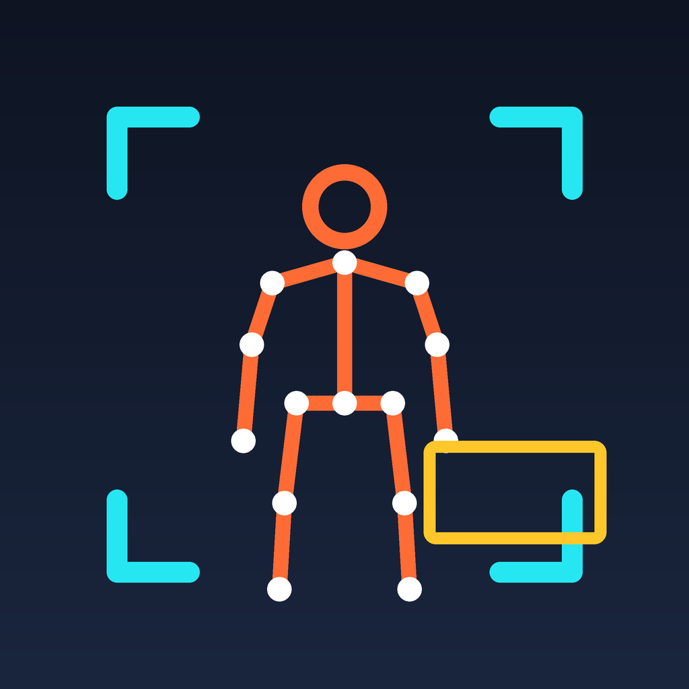

# 视觉相机 VisionCam

一个 iOS 实时视觉 App：**摄像头画面里，物体自动画框标注名称，人物额外画出骨架**。
全部推理在本机完成，不联网、不上传。



---

## 功能

| | 说明 |
|---|---|
| **物体识别** | YOLO11m（CoreML，COCO 80 类）实时检测，**全画面分块扫描**，画出方框 + 中文名称 + 置信度 |
| **人体姿态** | Vision `VNDetectHumanBodyPoseRequest`，19 个关键点 + 骨骼连线，附带人物外框 |
| **人物融合** | YOLO 的人物框与姿态骨架按 IoU 合并，一个人只画一个框；YOLO 扫过却没看到人时，姿态误报自动降权 |
| **实时叠加** | 相机画面 + 检测结果叠加显示，底部可开关各项检测、调置信度门槛、切换前后摄像头 |
| **性能监控** | 顶部实时显示 FPS、单帧推理耗时，以及物体 / 人物数量 |

界面配色约定：**青色框 = 人物**（姿态检测带骨架；姿态关闭时由 YOLO 的 person 类兜底），
**黄色框 = 其他物体**。

## v1.1.2 改了什么

物体框终于出来了，但**分类精度不够**：书架上的深蓝色瓶子被标成「书 95%」。

这不是阈值能解决的——模型确实以 95% 的置信度认为它是书。原因有三层：
YOLO11s 容量有限；画面本身失焦、细节少；COCO 的 `bottle` 类对非标准瓶子
（洗发水、饮料）召回本来就低。

**换模型**：YOLO11s → YOLO11m（9.4M → 20.1M 参数，mAP 47.0 → 51.5）。
代价是模型 19 MB → 39 MB、单次推理约慢 2.5 倍，帧率大致从 12 掉到 10。

> 如果你的机型跑 m 档明显卡顿，把 `ObjectDetector.modelName` 和
> `VisionCam/Models/` 换回 s 档即可，帧率会回来，误判也会多回去。

## v1.1.1 修了什么

v1.1.0 把检测范围从 56% 提到 100%，方向是对的，但漏了一个更致命的问题：
**物体检测的结果类型解析错了，黄色框从头到尾一个都没出现过**。
界面上看到的框，全部来自姿态检测 —— 所以才会出现「瓶子被标成人物」。

| 现象 | 原因 | 修复 |
|---|---|---|
| 物体数永远是 0，状态栏「识别异常」 | 带内置 NMS 的模型在 Vision 里返回 `VNRecognizedObjectObservation`，代码却按 `VNCoreMLFeatureValueObservation` 解析，类型转换必然失败 | 优先按对象观察值解析，原始张量解析留作兜底 |
| 瓶子被标成「人物 50%」并画出骨架 | 姿态模型对竖长物体（瓶子、灯杆）会给出完整 19 点骨架；之前没有 YOLO 结果做交叉验证，直接画了框 | YOLO 扫过该区域却没检出 person 时，姿态置信度 ×0.35；同时收紧关键点门槛 |

## v1.1.0 改了什么

1. **物体检测从「中心裁剪」改成「全画面分块扫描」** —— 覆盖率从 56% 提到 100%，
   画面上下边缘的杯子、书本、手机不再被直接丢掉；跨块边界的同一目标取并集补全。
2. **模型内置 NMS 门槛 0.25 → 0.10、IoU 0.7 → 0.45** —— 之前滑杆调到底也没用，
   低于 0.25 的目标在模型内部就被丢了；现在滑杆可以真正调到 10%。
3. **修掉背压失效** —— 原来「上一帧没跑完就丢帧」的判断写在串行队列内部，恒为假，
   帧会无限堆积，画面越用越滞后；改成在相机回调线程上同步判断。
4. **人物框融合** —— YOLO 的 person 框和姿态骨架按 IoU 合并，姿态漏检时人物仍然有框。
5. **解析失败不再静默** —— Vision 返回结构异常时状态栏直接显示「识别异常」。
6. 方框加入跨帧平滑，减少抖动。

## 性能与调度

相机以原生双平面 YUV 输出（每像素 1.5 字节，Vision 可直接消费，省掉一次色彩空间转换），
推理侧做了这几件事：

1. **复用 `VNCoreMLRequest`** —— 不再每帧重建；
2. **物体检测：每帧一次，瓦片轮转** —— 整幅画面切成互相重叠的正方形瓦片
   （竖屏 720×1280 切成 2 块 720×720，重叠 22%），每帧只跑其中一块，
   各块结果缓存后按 IoU 合并。每块约 15fps 刷新，合并后的整体仍跟随相机帧率。
3. **姿态检测：每两帧一次** —— 姿态比物体检测更吃时间，降到 15fps 肉眼几乎无感，
   省下的时间留给物体检测。平均每帧约 1.5 次推理（之前交替执行是 1 次），
   换来物体检测 100% 的画面覆盖；机型偏慢时关掉姿态即可回到 1 次。
4. **预取 `MLMultiArray` 裸指针与步长** —— 去掉内层循环里重复的 strides 计算。

如果仍然偏慢，可在底部关掉「姿态骨架」；也可以换回更小的模型档位（见下文「模型选择」）。

## 技术方案

### 物体检测

**模型选择**：`YOLO11m`（COCO 预训练，20.1M 参数，mAP 51.5）。

之前用的是 s 档（9.4M，mAP 47.0）。s 跑得快，但**分类精度不够**——
书架、桌面这种密集摆放的场景里，瓶子会被认成「书」，而且置信度还挺高（95%）。
换到 m 档后 mAP 提升 4.5 个点，代价是模型 19 MB → 39 MB、单次推理约慢 2.5 倍。

如果机型偏慢，可以把 `ObjectDetector.modelName` 和 `VisionCam/Models/` 换回 s 档，
帧率能回来，误判也会多回去。

自行导出（需 macOS 或 CI 的 macOS runner）：

```bash
pip install ultralytics coremltools "torch==2.7.0"   # coremltools 9.0 只测到 torch 2.7.0
python -c "from ultralytics import YOLO; YOLO('yolo11m.pt').export(format='coreml', nms=True, imgsz=640)"
python tools/patch_model.py yolo11m.mlpackage YOLO11m.mlpackage --conf 0.10 --iou 0.45
```

> torch 装成更高版本（如 2.14）会在转换时报
> `only 0-dimensional arrays can be converted to Python scalars`。

模型结构（Ultralytics 导出，**NMS 已内置在 pipeline 里**）：

```
输入  image       640×640 RGB
输出  confidence  [N, 80]    每行是一个框在 80 个类别上的置信度
      coordinates [N, 4]     每行 [cx, cy, w, h]，已归一化到 0~1
```

坐标格式依据 Apple CoreML 官方 proto（`NonMaximumSuppression.proto`）：
x/y 是**盒子中心点**，w/h 是宽高，且归一化到图像尺寸。

#### 分块扫描（这是检测范围的关键）

手机竖屏取景时画面是「高瘦」的（720×1280），而模型输入是正方形 640×640。
如果把整幅画面硬塞进 640×640，纵向会被压缩到 56%，小物体特征直接糊掉；
如果只取画面中心的正方形，虽然不失真，但**上下各 22% 的画面根本不在检测范围内**
——检测覆盖率只有 56%。

之前「只有人物能框出来」的观感就来自这里：人物由姿态检测负责，跑的是整幅画面，
所以人一直有框；而桌上的杯子、书本、手机只要不在画面正中间，物体检测压根看不到。

现在改成 **分块扫描**：

| 环节 | 做法 |
|---|---|
| 切块 | 沿长边切成若干个 `side × side` 的正方形瓦片（`side = min(宽, 高)`），相邻块重叠 22% |
| 推理 | 每帧只跑一块，用 CIImage 摆正后裁出正方形再送 Vision，轮转刷新 |
| 合并 | 各块结果映射回整幅画面坐标，同类别按 IoU 0.45 去重；被瓦片边界切开的同一目标取并集补全 |
| 失效 | 单块结果缓存 0.35 秒，超时不再参与合并，避免留下「鬼影」 |

竖屏 720×1280 切成 2 块，每块都是 **720×720 原分辨率 → 640×640**，
既没有形变，也没有二次缩小；合起来覆盖 100% 画面。每帧仍然只跑一次模型，耗时不变。

> **踩过的坑**：原始导出的模型除了 `image` 还带 `iouThreshold` /
> `confidenceThreshold` 两个必填标量输入，`VNCoreMLRequest` 无法提供，
> 会导致调用失败。本仓库内置的 `YOLO11m.mlpackage` 已用 coremltools 打补丁
> 移除这两个输入（清空 `*InputFeatureName`），让 NMS 回退使用内置参数，
> 从而只剩单个 `image` 输入，Vision 可以直接跑。打补丁的脚本见 `tools/patch_model.py`。

#### NMS 阈值

Ultralytics 导出的模型把 NMS 门槛写死在模型内部（默认置信度 0.25、IoU 0.7）。
App 端的滑杆只能在它**之上**做二次过滤，所以低于 0.25 的目标永远出不来。
本仓库的模型已经用 `tools/tune_nms.py` 把内置阈值调成：

| 参数 | 值 | 原因 |
|---|---|---|
| 置信度 | **0.10** | 让滑杆真正能往下调，接住杯子、书本这类弱目标 |
| IoU | **0.45** | 减少同一个物体被画好几个框 |

`tune_nms.py` 只改 `model.mlmodel` 这份 proto，不碰 `weights/weight.bin`，
可以随时重新调：

```bash
python tools/tune_nms.py VisionCam/Models/YOLO11m.mlpackage --conf 0.10 --iou 0.45
```

#### 输出解析

**这是 1.1.0 里物体框一个都出不来的真正原因。**

带内置 NMS 的 CoreML 模型在 Vision 里会被当成「对象检测模型」，
`request.results` 直接是 `[VNRecognizedObjectObservation]`，每个 observation
自带 `boundingBox` 和类别标签。早期版本按 `[VNCoreMLFeatureValueObservation]`
去解析张量，类型转换永远失败，于是每帧都返回「模型输出类型异常」，
物体检测从未出过一个框 —— 界面上所有框其实都来自姿态检测。

现在优先按 `VNRecognizedObjectObservation` 解析，拿不到时再回退到原始张量
（兼容不带 NMS 的模型）。张量分支同时兼容 `[N, C]` / `[C, N]` 两种排布，
按 strides 直接读裸指针，float32 / float16 / double 都支持。

任何一步失败都不会静默返回空数组，原因会带回引擎，顶部状态栏显示「**识别异常**」
——「模型没工作」和「模型没看到东西」能一眼区分开。

> **为什么不继续用 `regionOfInterest`**：它的坐标空间与 `orientation` 的组合
> 在不同 iOS 版本上表现不一致（竖屏时可能按未旋转的原始像素空间解释，
> 裁出来是一条竖带而不是横条），观察结果是否相对 ROI 归一化也有歧义。
> 改成先用 CIImage 把画面摆正、再按瓦片裁剪，送进 Vision 时固定 `orientation: .up`，
> 坐标从哪里来到哪里去完全可控。

### 姿态检测

`VNDetectHumanBodyPoseRequest` 输出 19 个关键点（归一化坐标，原点左下），
直接连线画骨架；再由关键点外接框推导人物方框。

**这个模型会把竖长物体认成人**：矿泉水瓶、灯杆、椅背都可能给出结构完整的
19 点骨架，置信度能到 50%。光提高阈值没用，因为远处真人的置信度也可能只有 50%。

所以做两层处理：

1. **廉价过滤**：单点 ≥ 0.35、至少 6 个点、平均 ≥ 0.45、且必须有躯干
   （脖子 / 双肩 / 双髋至少一组）。
2. **YOLO 交叉验证**：YOLO 已经扫过姿态框所在区域、却完全没检出 person 时，
   这个「人」的置信度乘 0.35。瓶子那种 50% 的误报落到 17%，
   默认 25% 门槛下不再显示。

姿态的框来自关键点外接框，会随手臂摆动跳动；YOLO 的 person 框更稳。
两者按 IoU > 0.2 匹配：

* 匹配上 → 用 **YOLO 的框** + **姿态的骨架**，置信度取较大值；
* 姿态漏检（侧身、被遮挡、只露出半个身子）→ 仍然保留 YOLO 的人物框，不会「人在画面里却没有框」。

### 方框平滑

相邻两帧按「同类别 + IoU > 0.25」匹配，匹配上的框做指数平滑（新值权重 0.6），
置信度也做同样处理。分块轮转让每块约 15fps 刷新，平滑能明显压住抖动。

### 坐标换算

Vision 坐标是「原点左下、归一化」的，预览层用 `.resizeAspectFill`。
`CoordinateMapper` 用同一套「等比放大 + 居中」把两边对齐，
所以框和骨架能严丝合缝地贴住画面里的物体。

App 锁定竖屏，因此方向映射是固定的：后置 `.right`、前置 `.leftMirrored`，
与预览层的默认显示保持一致。

## 目录结构

```
VisionCam/
├── project.yml                     # XcodeGen 工程描述（没有 .xcodeproj）
├── Support/                        # XcodeGen 生成的 Info.plist 落在这里
├── .github/workflows/
│   └── build-unsigned-ipa.yml      # 云端打未签名 IPA
├── tools/
│   ├── patch_model.py              # 移除 NMS 的必填输入 + 设定阈值
│   └── tune_nms.py                 # 原地调整已导出模型的内置 NMS 阈值
└── VisionCam/
    ├── VisionCamApp.swift
    ├── ContentView.swift
    ├── Assets.xcassets/
    ├── Camera/
    │   ├── CameraManager.swift     # 采集、权限、前后摄切换、逐帧回调
    │   └── CameraPreview.swift     # AVCaptureVideoPreviewLayer 的 SwiftUI 封装
    ├── Detection/
    │   ├── DetectionTypes.swift    # DetectedItem / Joint / 骨骼连接表 / IoU 工具
    │   ├── COCOLabels.swift        # COCO 80 类中英文名
    │   ├── ObjectDetector.swift    # YOLO11m + Vision，分块扫描与输出解析
    │   ├── PoseDetector.swift      # 人体姿态
    │   └── DetectionEngine.swift   # 调度、跨块合并、人物融合、平滑、性能统计
    ├── UI/
    │   ├── CoordinateMapper.swift  # Vision 归一化坐标 → 屏幕坐标
    │   ├── OverlayView.swift       # Canvas 画框 / 标签 / 骨架
    │   └── ControlPanel.swift      # 底部控制面板
    └── Models/
        └── YOLO11m.mlpackage       # 已打补丁的 CoreML 模型（39 MB）
```

## 构建

工程没有 `.xcodeproj`，用 [XcodeGen](https://github.com/yonaskolb/XcodeGen) 从
`project.yml` 现场生成：

```bash
brew install xcodegen
xcodegen generate
open VisionCam.xcodeproj
```

## 云端打包 IPA（不需要 Mac）

仓库自带 GitHub Actions workflow，推到 `main` 后自动构建：

```bash
gh run list --limit 3
gh run watch <run-id>
```

产物会出现在 **Releases** 页面（免登录下载）和当次运行的 Artifacts 区。

> ⚠️ 产出的是**未签名 IPA，不能直接安装**。需要用 Sideloadly / AltStore /
> SideStore 配合免费 Apple ID 重签，装完 **7 天**有效期，到期重签。

## 已知限制

- **未签名 IPA 有 7 天有效期**（免费 Apple ID 签名机制决定的，不是打包问题）。
- 模型是 COCO 80 类，**类别之外的物品（耳机、充电器、眼镜等）识别不出来**，
  这是类别集限制，换更大的模型也没用。
- 小目标仍然吃力：模型输入固定 640×640，太远的物体像素太少。凑近一点最有效。
- 分块轮转意味着每块约 15fps 刷新，快速平移镜头时非当前块的框可能略微滞后。
- 模型内部门槛已降到 0.10，滑杆调得很低时会出现一些误检，属于正常代价。
- App 锁定竖屏（横屏下坐标换算需要额外的方向处理）。

## 许可

仅供自用与学习。COCO 类别名来自公开数据集；YOLO11m 权重版权归 Ultralytics
（AGPL-3.0），商用请自行确认授权。
